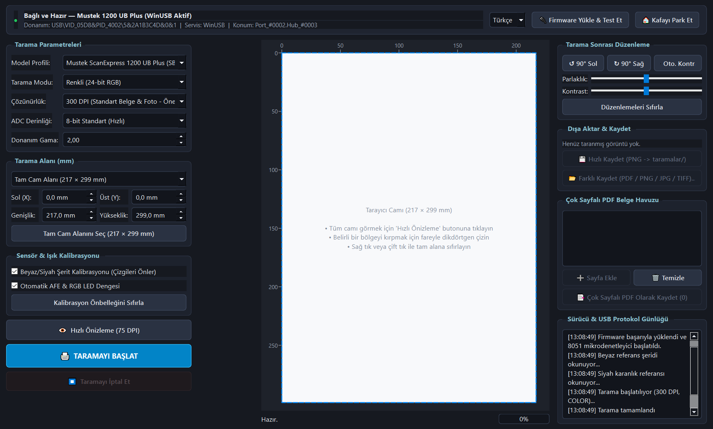
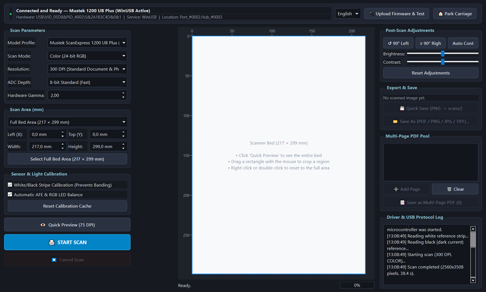
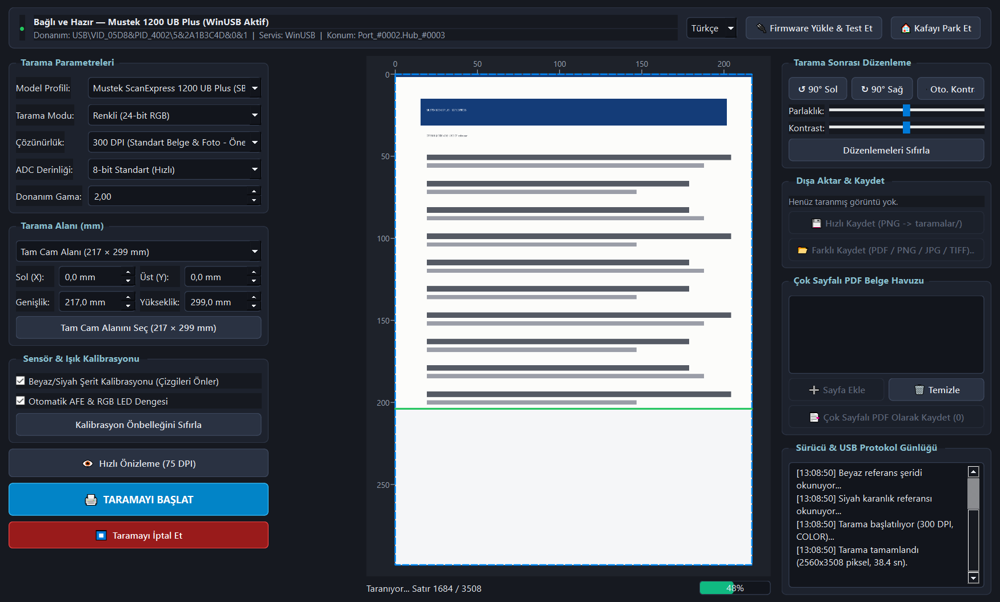
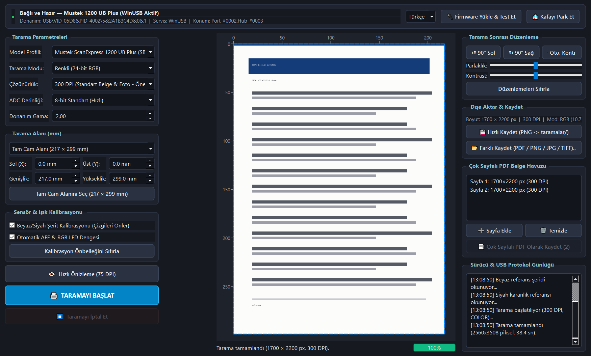

# Mustek 1200 UB Plus — Cross-Platform USB Driver & Scan Center

> Türkçe dokümantasyon: [README.tr.md](README.tr.md)

A user-mode USB driver and desktop scanning application for the **Mustek ScanExpress 1200 UB Plus** (and the related **Mustek BearPaw 1200 CU**, which shares the same GT-6801 chipset) on **Windows 10/11 and Linux**.

Hardware ID: `USB\VID_05D8&PID_4002` (`05d8:4002`).

## Highlights

- **No kernel driver required.** Uses Microsoft's signed `WinUSB.sys` on Windows and `libusb-1.0` on Linux.
- **Built-in GT-6801 firmware loader.** Uploads `SBfw.usb` / `PS1fw.usb` over USB control transfers at startup.
- **Automatic sensor calibration.** AFE gain/offset, RGB LED exposure balancing, and per-pixel black/white shading correction.
- **Live preview and crop.** 75 DPI quick preview plus millimetre-accurate crop selection with the mouse.
- **Flexible scanning.** 50–1200 DPI, color / grayscale / 1-bit line art, 8-bit and 12-bit ADC.
- **Post-processing.** Brightness, contrast, rotation, auto-contrast, and exports to PDF / PNG / JPG / TIFF / BMP.
- **Multi-page PDF.** Collect scanned pages in a pool and export a single PDF.
- **Live device detection.** Windows PnP (`CfgMgr32`) and Linux `udev` / `libusb` status monitoring.
- **Two languages.** Turkish and English UI, CLI help, logs, and error messages. The language is detected from the system locale, can be changed in the top bar, and is remembered.

## Screenshots

| Turkish interface | English interface |
| --- | --- |
|  |  |

| Live scan in progress | Scan result and multi-page PDF pool |
| --- | --- |
|  |  |


## Download

Ready-to-run binaries are published in the **Releases** section of the GitHub repository:

- `Mustek_1200_UB_Plus-Win64.exe` — portable Windows 10/11 x64 single-file executable.
- `Mustek_1200_UB_Plus-x86_64.AppImage` — portable Linux x86_64 AppImage.

Both bundles include the Python runtime, `libusb`, the firmware files, and (on Windows) `zadig-2.9.exe` for one-time WinUSB installation.

### Linux AppImage

```bash
chmod +x Mustek_1200_UB_Plus-x86_64.AppImage
./Mustek_1200_UB_Plus-x86_64.AppImage
```

For USB access as a normal user, click the **"🔐 Configure Linux USB Permission (udev)"** button or install the rule once:

```bash
sudo cp 99-mustek-1200ub.rules /etc/udev/rules.d/
sudo udevadm control --reload-rules && sudo udevadm trigger
```

## Run from source

Requirements: Python 3.10+ and the packages in `requirements.txt`.

```bash
python -m venv .venv
# Windows:
.venv\Scripts\activate
# Linux/macOS:
source .venv/bin/activate

pip install -r requirements.txt
python main.py
```

On Windows you can also double-click `baslat.bat`.

### First-time setup on Windows (once)

1. Start the application (`.exe`, `baslat.bat`, or `python main.py`).
2. Click **"⚡ Step 1: Install WinUSB with Zadig"**.
3. In Zadig:
   - Select **`Unknown Device #1`** (`05D8` `4002`). If it is not listed, enable **Options → List All Devices**.
   - Choose **`WinUSB`** as the target driver and click **Install Driver**.
4. The status banner turns green as soon as the scanner is ready.

## Command line

```bash
# Connection and driver status
python cli_test.py --status

# Upload firmware and verify the GT-6801 identity
python cli_test.py --test

# Move the carriage to the home position
python cli_test.py --home

# Scan at 300 DPI in color and save to a file
python cli_test.py --scan output.png --dpi 300 --mode color
```

## Architecture

| Layer | File | Responsibility |
| --- | --- | --- |
| USB transport | `driver/usb_transport.py` | WinUSB / libusb access, PnP status, bulk reads |
| Firmware protocol | `driver/gt6801_protocol.py` | GT-6801 control packets, firmware upload, scan setup |
| Calibration | `driver/calibration.py` | AFE, exposure, black/white shading correction |
| Scanner engine | `driver/scanner_engine.py` | Session lifecycle, scan streaming, image assembly |
| Localization | `driver/i18n.py` | Turkish/English runtime translation and preference storage |
| Desktop UI | `ui/main_window.py`, `ui/preview_canvas.py` | PyQt6 interface, live preview, crop selection |
| Entry point | `main.py` | Application bootstrap, logging, single-instance guard |

## Build

```powershell
# Windows x64 portable single-file executable (also runs a smoke test)
python packaging/build_windows.py
```

```bash
# Linux x86_64 AppImage (on Linux)
bash packaging/build_linux_appimage.sh
```

### Building the Linux AppImage with Docker

No Linux machine is required. Run the build script inside an Ubuntu 22.04 container:

```bash
docker run --rm -v "$PWD:/workspace" ubuntu:22.04 bash /workspace/packaging/build_linux_appimage.sh
```

The script installs its own dependencies, runs the tests and the smoke test, and writes `dist/Mustek_1200_UB_Plus-x86_64.AppImage`.

Build artifacts are written to `dist/` and are intentionally excluded from Git. GitHub Actions can build them automatically; see `.github/workflows/`.

## Tests

```bash
pip install -r requirements-dev.txt
python -m pytest -q
```

The end-to-end smoke test exercises firmware upload, scanning, image editing, and PDF export with a simulated USB transport:

```bash
python main.py --smoke-test
```

## Project layout

```text
main.py                     Application entry point
cli_test.py                 Command-line driver tool
driver/                     USB transport, protocol, calibration, engine, i18n
ui/                         PyQt6 widgets and main window
firmware/                   GT-6801 firmware images (SBfw.usb, PS1fw.usb)
assets/                     Icons and images
packaging/                  PyInstaller / AppImage / udev helpers
tests/                      Protocol unit tests
docs/PROTOCOL.md            Protocol notes
```

## Language support

- Available languages: **Türkçe** and **English**.
- Selection order: `MUSTEK_LANG` environment variable → saved preference → system locale → English.
- Changing the language in the top bar applies immediately and is stored in:
  - Windows: `%APPDATA%\Mustek1200UBPlus\settings.json`
  - Linux: `$XDG_CONFIG_HOME/mustek-1200-ub-plus/settings.json` (or `~/.config/...`)

To add a language, extend `LANGUAGES` and the translation table in `driver/i18n.py`.

## Troubleshooting

- **Scanner not detected:** check the USB cable and try another port. On Windows verify the device shows up with the WinUSB driver in Device Manager.
- **Access denied on Linux:** install the udev rule as shown above, then unplug and replug the scanner.
- **Windows "device is busy":** close other scanning applications (including a second instance of this app).
- **Log file:** `%TEMP%\mustek_1200_ub_plus.log` (Windows) or the system temp directory.

## Disclaimer

This is an independent community project. It is not affiliated with, endorsed by, or supported by Mustek. "Mustek", "ScanExpress", and "BearPaw" are trademarks of their respective owners. Use the software at your own risk; always verify important scans.

## License

[MIT](LICENSE)
