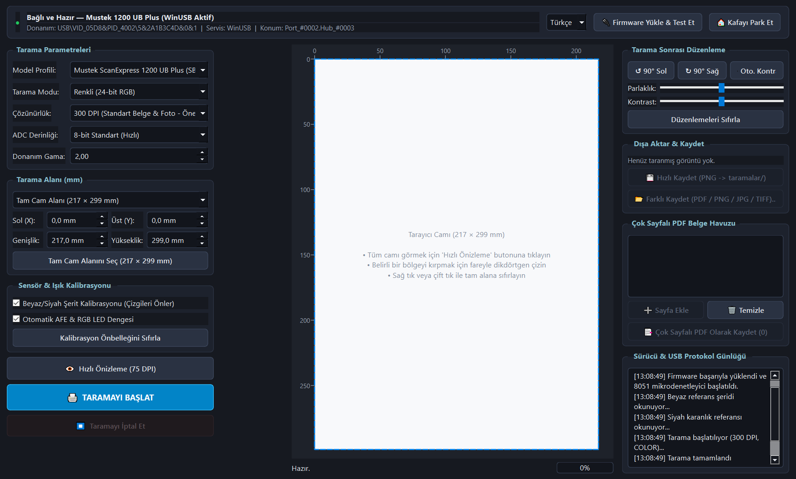
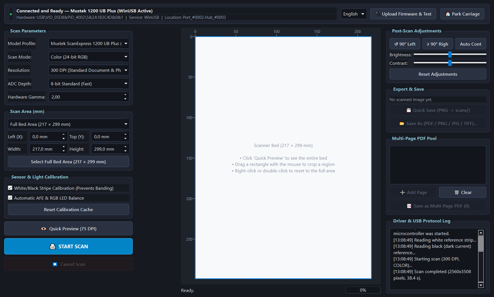
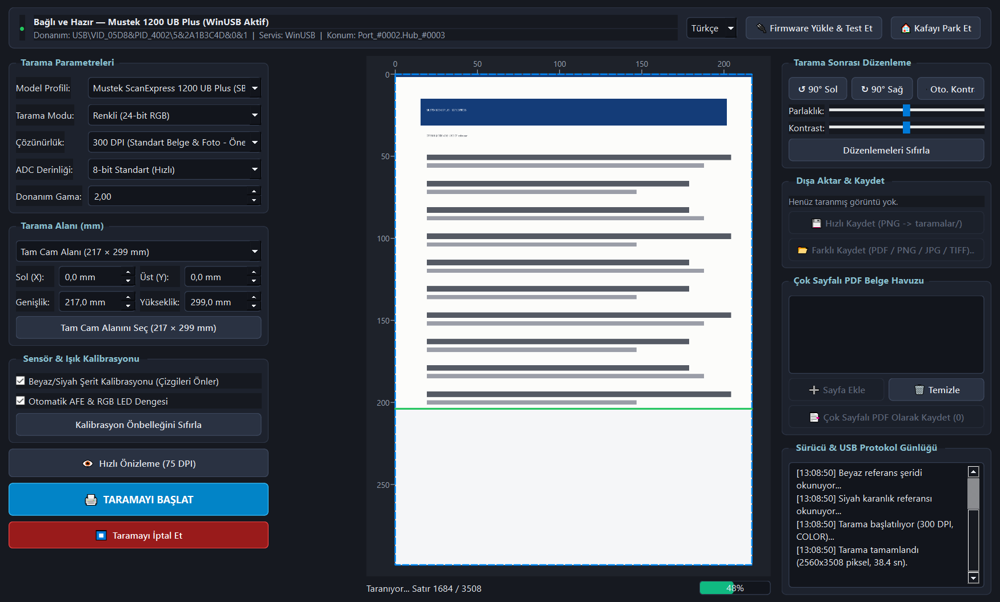
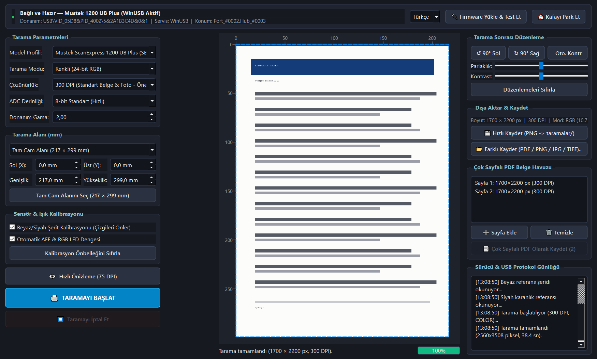

# Mustek 1200 UB Plus — Çapraz Platform USB Sürücüsü ve Tarama Merkezi

> English documentation: [README.md](README.md)

`USB\VID_05D8&PID_4002` (`05d8:4002`) donanım kimliğine sahip **Mustek ScanExpress 1200 UB Plus** (ve aynı GT-6801 yonga setini paylaşan **Mustek BearPaw 1200 CU**) tarayıcılar için **Windows 10/11 ve Linux** üzerinde çalışan kullanıcı modu USB sürücüsü ve masaüstü tarama uygulaması.

## Öne çıkan özellikler

- **Çekirdek sürücüsü gerekmez.** Windows'ta Microsoft imzalı `WinUSB.sys`, Linux'ta `libusb-1.0` kullanılır.
- **GT-6801 firmware yükleyici.** Açılışta `SBfw.usb` / `PS1fw.usb` USB kontrol paketleriyle yüklenir.
- **Otomatik sensör kalibrasyonu.** AFE kazanç/offset, RGB LED pozlama dengesi ve piksel bazlı siyah/beyaz shading düzeltmesi.
- **Canlı önizleme ve kırpma.** 75 DPI hızlı önizleme ve fareyle milimetrik bölge seçimi.
- **Esnek tarama.** 50–1200 DPI, renkli / gri tonlama / 1-bit metin, 8-bit ve 12-bit ADC.
- **Tarama sonrası düzenleme.** Parlaklık, kontrast, döndürme, otomatik kontrast; PDF / PNG / JPG / TIFF / BMP çıktısı.
- **Çok sayfalı PDF.** Taranan sayfaları havuzda toplayıp tek PDF olarak kaydetme.
- **Canlı cihaz takibi.** Windows PnP (`CfgMgr32`) ve Linux `udev` / `libusb` durum izleme.
- **İki dil.** Türkçe ve İngilizce arayüz, CLI yardımı, günlük ve hata mesajları. Dil sistem dilinden algılanır, üst çubuktan değiştirilebilir ve hatırlanır.

## Ekran görüntüleri

| Türkçe arayüz | İngilizce arayüz |
| --- | --- |
|  |  |

| Devam eden canlı tarama | Tarama sonucu ve çok sayfalı PDF havuzu |
| --- | --- |
|  |  |


## İndirme

Çalışmaya hazır ikili dosyalar GitHub deposunun **Releases** bölümünde yayınlanır:

- `Mustek_1200_UB_Plus-Win64.exe` — Windows 10/11 x64 taşınabilir tek dosya.
- `Mustek_1200_UB_Plus-x86_64.AppImage` — Linux x86_64 taşınabilir AppImage.

Her iki paket Python çalışma zamanını, `libusb`'i ve firmware dosyalarını içerir; Windows paketinde tek seferlik WinUSB kurulumu için `zadig-2.9.exe` de bulunur.

### Linux AppImage

```bash
chmod +x Mustek_1200_UB_Plus-x86_64.AppImage
./Mustek_1200_UB_Plus-x86_64.AppImage
```

Normal kullanıcı olarak USB erişimi için üst çubuktaki **"🔐 Linux USB İzni Tanımla (udev)"** butonuna tıklayın veya kuralı bir kez kurun:

```bash
sudo cp 99-mustek-1200ub.rules /etc/udev/rules.d/
sudo udevadm control --reload-rules && sudo udevadm trigger
```

## Kaynak koddan çalıştırma

Gereksinimler: Python 3.10+ ve `requirements.txt` içindeki paketler.

```bash
python -m venv .venv
# Windows:
.venv\Scripts\activate
# Linux/macOS:
source .venv/bin/activate

pip install -r requirements.txt
python main.py
```

Windows'ta `baslat.bat` dosyasına çift tıklayarak da başlatabilirsiniz.

### Windows ilk kurulum (yalnızca bir kez)

1. Uygulamayı başlatın (`.exe`, `baslat.bat` veya `python main.py`).
2. **"⚡ 1. Adım: Zadig ile WinUSB Kur"** butonuna tıklayın.
3. Zadig penceresinde:
   - **`Unknown Device #1`** (`05D8` `4002`) seçili olsun. Görünmüyorsa **Options → List All Devices** işaretleyin.
   - Hedef sürücü olarak **`WinUSB`** seçip **Install Driver** butonuna tıklayın.
4. Tarayıcı hazır olduğunda üst durum çubuğu yeşile döner.

## Komut satırı

```bash
# Bağlantı ve sürücü durumu
python cli_test.py --status

# Firmware yükle ve GT-6801 kimliğini doğrula
python cli_test.py --test

# Tarama kafasını başlangıç (Home) konumuna çek
python cli_test.py --home

# 300 DPI renkli tarama yapıp dosyaya kaydet
python cli_test.py --scan cikti.png --dpi 300 --mode color
```

## Mimari

| Katman | Dosya | Görev |
| --- | --- | --- |
| USB aktarımı | `driver/usb_transport.py` | WinUSB / libusb erişimi, PnP durumu, bulk okuma |
| Firmware protokolü | `driver/gt6801_protocol.py` | GT-6801 kontrol paketleri, firmware yükleme, tarama kurulumu |
| Kalibrasyon | `driver/calibration.py` | AFE, pozlama, siyah/beyaz shading düzeltmesi |
| Tarama motoru | `driver/scanner_engine.py` | Oturum yönetimi, canlı akış, görüntü birleştirme |
| Dil desteği | `driver/i18n.py` | Türkçe/İngilizce çalışma zamanı çevirisi ve tercih saklama |
| Masaüstü arayüzü | `ui/main_window.py`, `ui/preview_canvas.py` | PyQt6 arayüzü, canlı önizleme, kırpma seçimi |
| Giriş noktası | `main.py` | Uygulama başlatma, günlük, tek örnek kilidi |

## Derleme

```powershell
# Windows x64 taşınabilir tek dosya (.exe) — duman testini de çalıştırır
python packaging/build_windows.py
```

```bash
# Linux x86_64 AppImage (Linux üzerinde)
bash packaging/build_linux_appimage.sh
```

### Docker ile Linux AppImage derleme

Linux makinesine ihtiyaç yoktur. Derleme betiğini Ubuntu 22.04 konteynerinde çalıştırın:

```bash
docker run --rm -v "$PWD:/workspace" ubuntu:22.04 bash /workspace/packaging/build_linux_appimage.sh
```

Betik bağımlılıkları kendisi kurar, testleri ve duman testini çalıştırır, ardından `dist/Mustek_1200_UB_Plus-x86_64.AppImage` dosyasını üretir.

Derleme çıktıları `dist/` klasörüne yazılır ve Git'e dahil edilmez. GitHub Actions ile otomatik derleme için `.github/workflows/` klasörüne bakın.

## Testler

```bash
pip install -r requirements-dev.txt
python -m pytest -q
```

Uçtan uca duman testi; firmware yükleme, tarama, görüntü düzenleme ve PDF dışa aktarma zincirini sanal USB aktarımıyla doğrular:

```bash
python main.py --smoke-test
```

## Proje yapısı

```text
main.py                     Uygulama giriş noktası
cli_test.py                 Komut satırı sürücü aracı
driver/                     USB aktarımı, protokol, kalibrasyon, motor, i18n
ui/                         PyQt6 bileşenleri ve ana pencere
firmware/                   GT-6801 firmware dosyaları (SBfw.usb, PS1fw.usb)
assets/                     Simgeler ve görseller
packaging/                  PyInstaller / AppImage / udev yardımcıları
tests/                      Protokol birim testleri
docs/PROTOCOL.md            Protokol notları
```

## Dil desteği

- Kullanılabilir diller: **Türkçe** ve **English**.
- Seçim sırası: `MUSTEK_LANG` ortam değişkeni → kaydedilmiş tercih → sistem dili → İngilizce.
- Üst çubuktan dil değiştirildiğinde arayüz anında güncellenir ve tercih şurada saklanır:
  - Windows: `%APPDATA%\Mustek1200UBPlus\settings.json`
  - Linux: `$XDG_CONFIG_HOME/mustek-1200-ub-plus/settings.json` (veya `~/.config/...`)

Yeni dil eklemek için `driver/i18n.py` içindeki `LANGUAGES` sözlüğünü ve çeviri tablosunu genişletin.

## Sorun giderme

- **Tarayıcı bulunamıyor:** USB kablosunu ve farklı bir USB portunu deneyin. Windows'ta Aygıt Yöneticisi'nde WinUSB sürücüsünün göründüğünü kontrol edin.
- **Linux'ta erişim reddedildi:** Yukarıdaki udev kuralını kurun, ardından tarayıcının USB kablosunu çıkarıp takın.
- **Windows "cihaz meşgul":** Tarayıcıyı kullanan diğer uygulamaları (bu uygulamanın ikinci bir örneği dahil) kapatın.
- **Günlük dosyası:** `%TEMP%\mustek_1200_ub_plus.log` (Windows) veya sistem geçici klasörü.

## Yasal uyarı

Bu bağımsız bir topluluk projesidir. Mustek ile bağlantılı değildir, Mustek tarafından desteklenmez. "Mustek", "ScanExpress" ve "BearPaw" ilgili sahiplerinin ticari markalarıdır. Yazılımı kendi sorumluluğunuzda kullanın; önemli taramaları her zaman doğrulayın.

## Lisans

[MIT](LICENSE)
